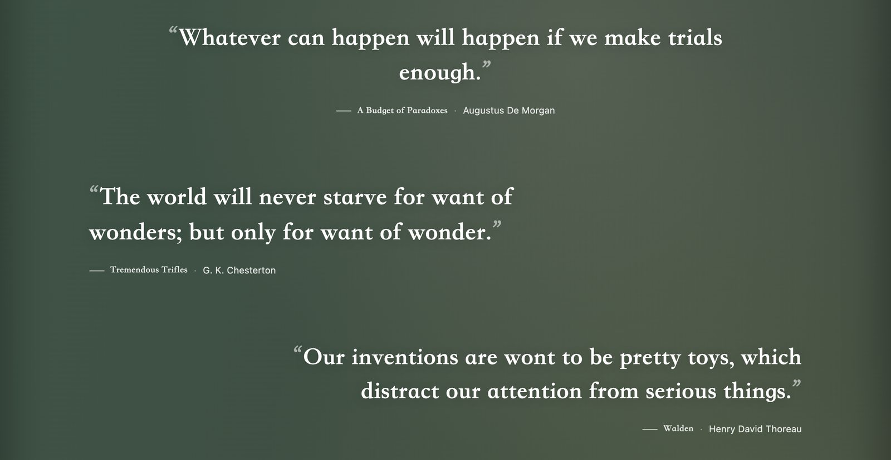

# Reveal

  
  
<em>Reveal highlights. Review books.</em>

  

Reveal is a reader for your [Readmoo](https://readmoo.com) book highlights. 
- View highlights by books, random, or all.
- Organize books into folders.
- Works on desktop, tablet and phone.
- Everything runs in your browser, Your data stays on your device.

## Getting started

1. Export your highlights from Readmoo as CSV files.
2. Open Reveal and import the CSV files.

## Backups
Nothing is uploaded: the website only serves the app's files and never sees your highlights.
Use a backup to move your library to another browser or device.

- **Download a backup:** Library → **Download backup (.json)**. Settings such as font size and theme are not included.
- **Restore:** drop the `.json` file onto the window, or Library → **Restore or merge from backup…**. Choose **Merge into current** to add only what's missing, or **Replace everything**.
- **Auto-save to a file (Chrome):** Library → **Open library file…** links a JSON file on your computer, which Reveal rewrites after every change.
