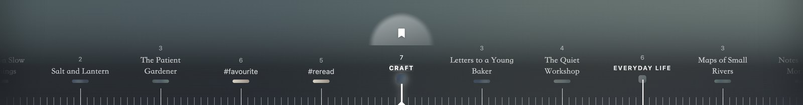

# Reveal

  
  
<em>Reveal highlights. Review books.</em>

  

Reveal is a reader for your [Readmoo](https://readmoo.com) book highlights. Import Readmoo's CSV exports and review your quotes one screen at a time.

- Edit quotes with rich text, and add notes and tags
- Organise books into folders, and give each book its own background or colour theme
- Search and filter across everything you've highlighted
- Works on desktop, tablet and phone

## Your data stays on your device

Everything runs in your browser. Imported CSVs are read on your device, and your library is saved in the browser's own storage (IndexedDB). Nothing is uploaded: the website only serves the app's files and never sees your highlights.

Because of that:

- **Your library belongs to one browser on one device.** It doesn't sync to your phone or another browser.
- **Clearing your browser's site data deletes it.** Keep a backup (below).

## Getting started

1. Export your highlights from Readmoo as a CSV file, one file per book.
2. Open Reveal and drop the CSV files onto the window, or choose **Choose CSV files**.
3. Readmoo's CSV has no book title, so Reveal suggests one from the file name. Check or edit it in the import dialog. Choosing an existing title adds the highlights to that book.

Importing the same file again later only adds highlights you don't already have.

## Using it

- **Next and previous quote:** scroll, swipe, or use the arrow keys and Page Up / Page Down.
- **Choose a book, folder or tag:** hover over (or tap) the bookmark tab at the bottom to open the ruler, then scroll or swipe to an item. Press <kbd>B</kbd> to open it from the keyboard and <kbd>Esc</kbd> to close it.
- **Random mix and All:** use the dice and the All button in the top bar.
- **Library:** click the app icon to manage books and folders, rename, move, delete, and make backups.
- **Settings:** quotes per scroll, font size, text position, order, blur, backgrounds, cursor and colour theme.

## Backups

- **Download a backup:** Library → **Download backup (.json)**. Settings such as font size and theme are not included.
- **Restore:** drop the `.json` file onto the window, or Library → **Restore or merge from backup…**. Choose **Merge into current** to add only what's missing, or **Replace everything**.
- **Auto-save to a file (Chrome and Edge):** Library → **Open library file…** links a JSON file on your computer, which Reveal rewrites after every change. The dot on the app icon is green while it's saving and orange when the browser needs your permission again. This also works from **…or open an existing library file** on the welcome screen, which keeps saving to that file, so don't use it on a backup you want to keep unchanged.

Use a backup to move your library to another browser or device.
